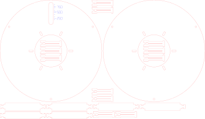

# Laser-cut filament spool

So, funny story: I bought a bunch of filament and only noticed afterwards that it was the
**refill** kind. No spool. Just a naked coil of plastic held together by a cardboard ring.

Turns out you can't "just quickly" swap that onto something else either. You need an empty
spool that comes apart, and I didn't have one.

What I did have was a laser cutter. So I made my own spools, and since they turned out
pretty well, here are the files.

Compatible with Bambu Lab filament refills.

**It holds together really well, with zero glue.** Everything is press-fit plus a few little
snap-on clips.



## What you need

Just **[`spool.svg`](spool.svg)**. One sheet, one complete spool:

- 2 flanges (Ø174 mm), one with a fill-level window
- 6 ribs
- 12 clips

It needs 350 × 204 mm of 3 mm plywood. Red lines are cuts, blue lines are a light score
(the gram scale next to the window). Board narrower than 350 mm? See `SHEET` under
[Changing things](#changing-things).

## Cutting

I used 3 mm basswood plywood on an xTool S1 (40 W):

- Cut: 100 % power, 15 mm/s
- Score: 50 % power, 100 mm/s

Your machine and your wood will want different numbers.

## Putting it together

1. Push the 6 ribs through the slots of one flange.
2. Snap a clip onto each rib end sticking out on the outside.
3. Slide the refill over the ribs.
4. Put the second flange on and snap on the other 6 clips.
5. Cut the zip ties of the refill. Done.

## Changing things

If the fit is too loose or too tight, or your refill has different dimensions, edit the
values at the top of [`spool.py`](spool.py) and run it. No dependencies needed.

```bash
python3 spool.py
```

That rewrites `spool.svg`. Worth knowing:

- `SHEET`: your board size, e.g. `(340, 270)`. If the compact 350 × 204 layout does not fit,
  the flanges go into opposite corners and the ribs and clips fill the free corners (with a
  2 mm margin to the edge). For a Ø174 spool, 340 × 250 mm works; the narrower the board,
  the taller it has to be. The script tells you if your board is too small.
- `KERF`: raise it if the ribs sit too loose in the slots.
- `THROAT`: raise it a little if the clips break while you push them on.
- `OD`: flange diameter. 174 saves wood, full-size spools are around 200.
- `R_FULL_MEASURED`: set it if you want the gram scale accurate for your filament.

## Good to know

- I use this on a Prusa CORE One+ and an MK4S, works great.
- Not tested in a Bambu Lab AMS. At Ø174 it is probably too small for it, around Ø200
  should be in the right range.
- Measure your refill's core before cutting. The file assumes about 82 mm inside and
  60 mm wide.

Have fun, and may you read the product title more carefully than I did.

## License

[CC BY-NC-SA 4.0](LICENSE). In short: use it, change it, share it, just give credit, keep it
under the same license, and don't sell it. I'm not making money with this and I'd like it
to stay that way for everyone.

This is a hobby project. It is not affiliated with or endorsed by Bambu Lab.
