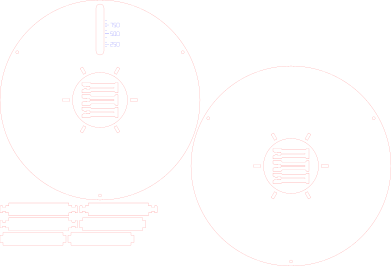

# Laser-cut filament spool

So, funny story: I bought a bunch of filament and only noticed afterwards that it was the
**refill** kind. No spool. Just a naked coil of plastic held together by a cardboard ring.

Turns out you can't "just quickly" swap that onto something else either. You need an empty
spool that comes apart, and I didn't have one.

What I did have was a laser cutter. So I made my own spools, and since they turned out
pretty well, here are the files.

Compatible with Bambu Lab filament refills.

**It holds together really well, with zero glue.** Everything is press-fit plus a few little
snap-on clips.



## What you get

| File | What it is |
|---|---|
| `komplett.svg` | One complete spool, tightly nested on a single sheet (391 × 266 mm) |
| `doppel_A.svg`, `doppel_B.svg` | Two slightly smaller spools (Ø174) on one 510 × 320 mm board, cut in two jobs |
| `spule.svg` | Just the two flanges and plain ribs |
| `riegel.svg` | The lockable ribs (they stick out through the flange) |
| `clips.svg` | The snap-on clips that lock those ribs in place |

Red lines are cuts, blue lines are a light score (the fill-level scale).

## How it works

- Two round flanges with six slots each.
- Six ribs go through those slots and form the hub that the filament coil sits on.
- The ribs poke out on the outside and have a narrow neck. A small clip snaps onto each
  neck, and that's what keeps the whole thing from coming apart.
- One flange has a little window with a gram scale, so you can roughly see how much
  filament is left.

To load it: build one side, slide the refill coil over the hub, put the second flange on,
snap the clips on, then cut the zip ties of the refill. Done.

## Cutting

I used 3 mm basswood plywood on an xTool S1 (40 W):

- Cut: 100 % power, 15 mm/s
- Score (the scale): 50 % power, 100 mm/s

Your machine and your wood will want different numbers. If the parts come out too loose or
too tight, change `KERF` in the scripts and regenerate.

## Changing things

The SVGs are generated by small Python scripts, no dependencies needed:

```bash
python3 gen_all.py
```

```bash
python3 gen_doppel.py
```

Everything worth tweaking is at the top of each script:

- `gen_spule.py`: outer diameter, bore, hub diameter, inner width, fill-gauge calibration
- `gen_riegel.py`: the lockable ribs
- `gen_clip.py`: clip tightness (`THROAT`, `SEAT`), length, how many you want (`CLIP_N=5 python3 gen_clip.py`)

## Good to know

- I use the small Ø174 version on a Prusa CORE One+ and an MK4S, works great.
- The default flange is Ø200. The two-on-one-board version is Ø174 to save wood.
- Not tested in a Bambu Lab AMS. The Ø200 size should be in the right range for it, the Ø174 one is probably too small.
- Measure your refill's core before cutting. The files assume about 82 mm inside and 60 mm wide.
- The fill gauge is an estimate based on PLA density. Set `R_FULL_MEASURED` if you want it
  accurate for your filament.
- The clips went through a few rounds. If yours snap while pushing them on, loosen
  `THROAT` a bit.

Have fun, and may you read the product title more carefully than I did.

## License

[CC BY-NC-SA 4.0](LICENSE). In short: use it, change it, share it, just give credit, keep it
under the same license, and don't sell it. I'm not making money with this and I'd like it
to stay that way for everyone.

This is a hobby project. It is not affiliated with or endorsed by Bambu Lab.
